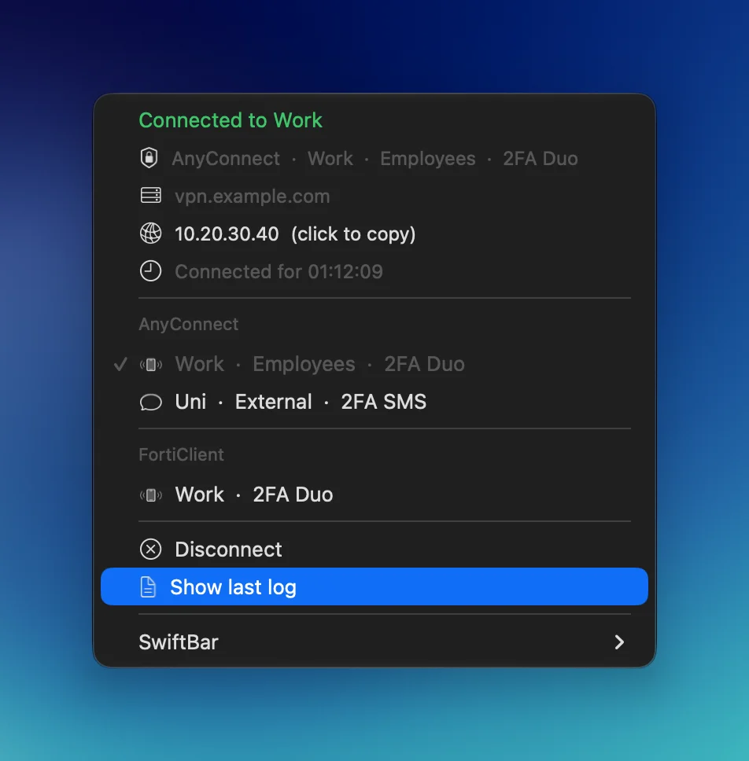

# swiftbar-vpn

[](#requirements)
[](https://github.com/swiftbar/SwiftBar)
[](LICENSE)

All your VPNs behind one macOS menu bar icon. Cisco AnyConnect and FortiGate SSL VPN, with Duo push or SMS as the second factor, one click away in [SwiftBar](https://github.com/swiftbar/SwiftBar).

<p align="center">
  
</p>

## Features

- **One click per VPN.** While connecting, the menu shows what it's waiting for (Duo push, SMS code, browser sign-in) and offers Cancel.
- **Notifications** when Duo needs approval, when you're connected, why a connection failed and when it drops, with Reconnect.
- **Passwords only in Keychain.** 2FA stays manual: approve Duo on your phone, type SMS codes into a dialog.
- **A locked-down root helper** for openfortivpn instead of a sudoers rule that hands out root.
- **DNS fallback.** VPN servers are pinned in `/etc/hosts`, so a broken DNS doesn't lock you out.

This is a starting point, not a product: the generic version of the setup I use every day. The write-up is on [rebjak.com](https://rebjak.com/en/blog/all-vpns-in-the-macos-menu-bar/).

## Requirements

- macOS on Apple Silicon with Homebrew in `/opt/homebrew`
- [SwiftBar](https://github.com/swiftbar/SwiftBar)
- Cisco Secure Client 5.x for `anyconnect` profiles, from your VPN portal
- [openfortivpn](https://github.com/adrienverge/openfortivpn) for `forticlient` profiles, the FortiClient app isn't used

## Quick start

```bash
brew install --cask swiftbar
brew install openfortivpn

git clone https://github.com/jozefrebjak/swiftbar-vpn.git ~/swiftbar-vpn
~/swiftbar-vpn/install.sh                      # links scripts into ~/bin, creates vpn.conf
$EDITOR ~/swiftbar-vpn/vpn.conf                # describe your VPNs
security add-generic-password -U -a jdoe -s vpn.example.com -w   # one per AnyConnect profile
sudo ~/swiftbar-vpn/helper/install-helper.sh   # root helper for FortiClient and /etc/hosts
```

Then point SwiftBar's **Plugin Folder** at `~/bin/swiftbar`. From a terminal, `vpn-connect work` and `vpn-connect off` do the same.

### Demo

To see the menu without any VPN, or to take screenshots, add a demo icon with fake profiles:

```bash
~/swiftbar-vpn/examples/demo/demo.sh              # connected
~/swiftbar-vpn/examples/demo/demo.sh connecting   # waiting for Duo
~/swiftbar-vpn/examples/demo/demo.sh remove
```

## Configuration

One VPN per line in `vpn.conf`, `-` where a column doesn't apply:

```text
# id        type         label  host                  group      user  2fa
work        anyconnect   Work   vpn.example.com       Employees  jdoe  duo
uni         anyconnect   Uni    ra.example.edu        External   jdoe  sms
work-forti  forticlient  Work   fw.example.com:10443  -          -     duo
```

| Column | Meaning |
| --- | --- |
| `id` | Argument for `vpn-connect`, unique across clients. |
| `type` | `anyconnect` or `forticlient`, also the section in the menu. |
| `label` | Name shown in the menu. |
| `host` | Gateway. FortiClient needs `host:port`. |
| `group` | AnyConnect group. |
| `user` | AnyConnect username and Keychain account. |
| `2fa` | `duo`, `sms` or `-`. |

> [!IMPORTANT]
> The root helper copies the host list at install time. Run `sudo helper/install-helper.sh` again after adding or changing a host.

## Security

openfortivpn and `/etc/hosts` need root, and SwiftBar can't type a sudo password. The obvious `NOPASSWD: /opt/homebrew/bin/openfortivpn` is a root shell for anything running as your user, because Homebrew files and openfortivpn's configs are writable by you.

`install-helper.sh` instead:

- installs root-owned copies of openfortivpn and its OpenSSL libraries in `/usr/local/libexec/swiftbar-vpn/`
- generates a root-owned `helper` that accepts only `forti-connect <host:port>`, `forti-stop` and `hosts-update`, for hosts from `vpn.conf`
- runs openfortivpn with a clean environment, a root-owned config and the system CA bundle
- writes `/etc/sudoers.d/swiftbar-vpn` with exactly those commands, validated by `visudo`

AnyConnect passwords are read from Keychain inside `expect` right before they're sent, so they never sit in an environment variable.

> [!WARNING]
> The helper is a snapshot. After `brew upgrade openfortivpn` or `openssl@4`, run the installer again.

To remove everything, including the `/etc/hosts` block:

```bash
sudo ~/swiftbar-vpn/helper/install-helper.sh --uninstall
```

## Roadmap

OpenVPN and WireGuard. New clients follow the same shape: a `type` branch in `bin/vpn-connect`, a command in the root helper and a state check in the plugin.

## License

[MIT](LICENSE)
